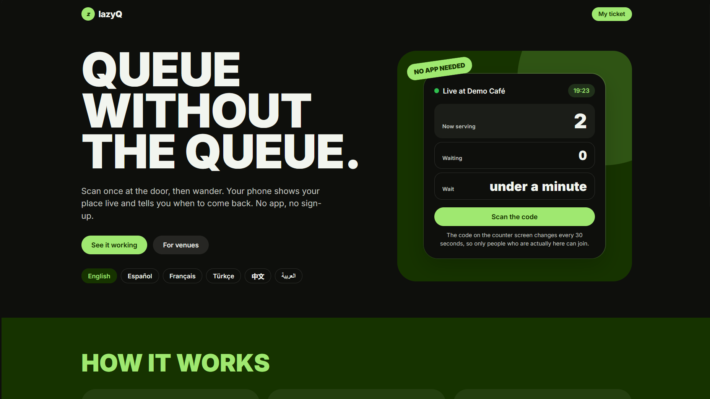
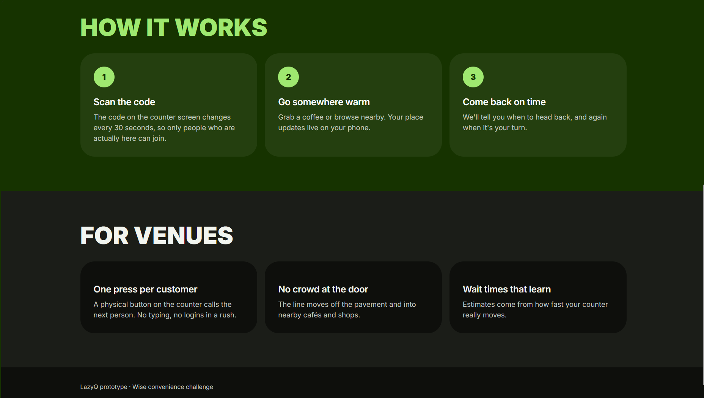
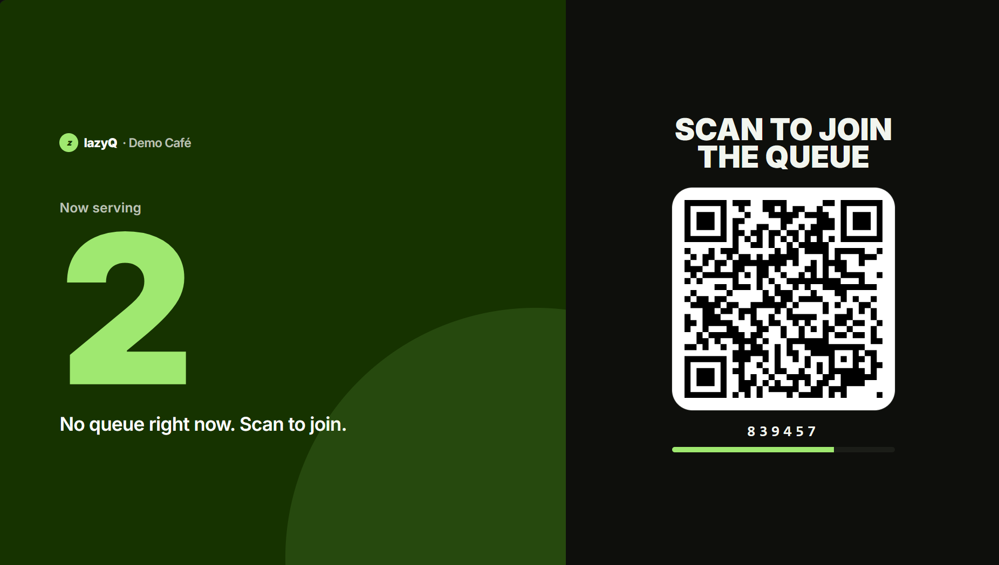
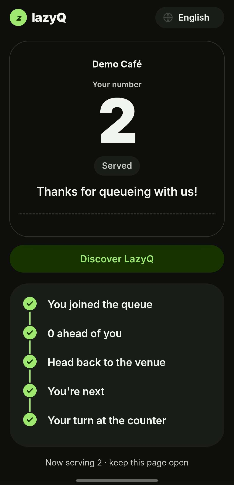
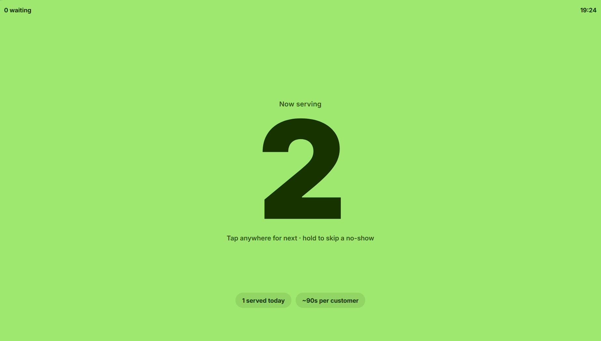

# LazyQ
### Less waiting. More living.

**A smarter, simpler way to wait in line.**

LazyQ is a lightweight, web-based virtual queue management system that lets customers join a queue by scanning a QR code — **no app downloads, no accounts, and no unnecessary waiting in line.**

Instead of standing in a physical queue, customers can explore nearby, grab a coffee, or simply relax while tracking their position in real time.

Built for the **IKU Womxn in STEM Hackathon 2026**, LazyQ reimagines everyday waiting experiences through accessible, intuitive technology.

🌐 **[Try LazyQ Live](https://lazyq.onrender.com)**

---

##  Why LazyQ?

Waiting in line is a frustrating part of everyday life. Whether at cafés, university offices, events, or service counters, traditional queues waste time and create unnecessary congestion.

**LazyQ makes waiting flexible.**

-  **Scan & Join:** Enter a virtual queue instantly using a QR code.
-  **Real-Time Updates:** Follow your queue position and estimated waiting time.
-  **Freedom to Roam:** Move around instead of standing in line.
-  **Smart Alerts:** Receive visual updates and optional sound or vibration alerts.
-  **Multilingual Access:** Use LazyQ in six languages.
-  **Simple Staff Dashboard:** Manage the queue with just a few clicks.
-  **Rotating QR Codes:** Joining codes refresh every 30 seconds.

No installation. No registration. Just scan and go.

---

##  Screenshots & Demo

### 1. Landing Page

A welcoming, responsive interface introducing customers to LazyQ.




### 2. Venue Screen — Scan to Join

Venues display a dynamically generated QR code alongside the current queue status.



### 3. Customer Ticket — Your Queue, Live

Customers receive a digital ticket showing their position, estimated waiting time, and live queue progress.



### 4. Staff Dashboard — Queue Management

Staff can call the next customer, monitor waiting tickets, and view queue statistics.




##  How It Works

**For customers**

1. Scan the QR code displayed at the venue.
2. Receive a digital queue ticket automatically.
3. Track your position and estimated waiting time in real time.
4. Continue your day while staying informed.
5. Return when LazyQ indicates your turn is approaching.

**For venue staff**

1. Open the staff dashboard.
2. Monitor the queue and current ticket numbers.
3. Call the next customer with a single action.
4. See changes reflected instantly on customer phones and the venue screen.

**One queue. Three connected experiences.**

---

##  Accessibility & Languages

LazyQ is designed to be accessible to a diverse range of users.

Supported languages:

- 🇬🇧 English
- 🇪🇸 Spanish
- 🇫🇷 French
- 🇹🇷 Turkish
- 🇨🇳 Chinese
- 🇸🇦 Arabic


The venue counter screen remains in English.

Because LazyQ runs directly in the browser, customers don't need to install an application or create an account.

---

##  Tech Stack

| Technology | Purpose |
|---|---|
| HTML5 | Page structure and user interfaces |
| CSS3 | Responsive design and visual styling |
| JavaScript | Interactive features, QR generation, and live updates |
| Python 3 | Backend server and queue management |
| Server-Sent Events (SSE) | Real-time updates between server and clients |
| QR Code Generator | Dynamic QR-code creation |
| JSON | Lightweight queue-state storage |
| Git & GitHub | Version control and team collaboration |
| Render | Cloud hosting and deployment |

**Why this stack?**

LazyQ prioritizes simplicity, accessibility, and ease of deployment. The backend uses Python's standard library, avoiding the need for additional Python packages.

---


---

##  How to use

### Prerequisites

- Python 3
- A modern web browser
- Git (optional)

No additional Python dependencies are required.

### 1. Clone the repository

```bash
git clone https://github.com/RZ481/lazyQ.git
cd lazyQ
```

Switch to the project branch if needed:

```bash
git switch backend
```

### 2. Start the server

On Windows:

```bash
python server.py
```

On macOS or Linux:

```bash
python3 server.py
```

### 3. Open the application

Once the server starts, visit:

| Page | Local URL |
|---|---|
| Landing Page | http://localhost:8000 |
| Venue Screen | http://localhost:8000/venue.html |
| Customer Ticket | http://localhost:8000/ticket.html |
| Staff Dashboard | http://localhost:8000/staff.html |

**Testing with multiple devices**

Connect your laptop and phones to the same Wi-Fi network or mobile hotspot.

Open the venue screen using your laptop's local IP address:

```text
http://<laptop-ip>:8000/venue.html
```

Customers can then scan the displayed QR code using their phones.

Make sure your firewall permits connections to the local server.

---

##  Live Deployment

LazyQ is deployed using **Render**, allowing the application to be accessed online without running a local server.

**Live application:**

https://lazyq.onrender.com

**Application pages:**

| Interface | Live URL |
|---|---|
| Home | https://lazyq.onrender.com |
| Venue Screen | https://lazyq.onrender.com/venue.html |
| Customer Ticket | https://lazyq.onrender.com/ticket.html |
| Staff Dashboard | https://lazyq.onrender.com/staff.html |

For the intended customer experience, scan the QR code on the venue screen rather than navigating directly to the ticket page.


**Note:** On the free hosting tier, the server may take extra time to respond after a period of inactivity. Queue data stored locally is not guaranteed to survive restarts or redeployments.

---

---

##  Security & Current Limitations

LazyQ is currently a **hackathon prototype**, designed to demonstrate the core virtual queue experience.

Some features require further development before production use:

- **Staff authentication:** The demo uses a shared staff key in frontend configuration. A production system needs secure, server-managed staff authentication.
- **Persistent storage:** JSON file storage should be replaced with a persistent database.
- **Scalability:** Production deployments would benefit from stronger concurrency controls and support for multiple venues.
- **Notifications:** Browser sound and vibration alerts depend on device permissions and browser support.
- **Location-based features:** These require appropriate browser permissions and secure HTTPS access.

Rotating QR codes provide a time-limited joining mechanism, but they are not a substitute for full authentication or abuse prevention.

---

##  Future Improvements

LazyQ has the potential to grow beyond its initial prototype.

Planned possibilities include:

-  Multi-venue queue management
-  Advanced analytics for venue owners
-  Push notifications
-  Improved location-aware return reminders
-  Secure staff accounts and role-based permissions
-  Persistent cloud database
-  Enhanced accessibility features
-  Smarter waiting-time predictions

Our vision is to make virtual queuing accessible to businesses and customers everywhere.

---

##  Team & Collaboration

Developed collaboratively for the **IKU Womxn in STEM Hackathon 2026**.

This project combines frontend development, backend engineering, user experience design, and real-time communication to create a practical solution to an everyday problem.

**GitHub repository:** [RZ481/lazyQ](https://github.com/RZ481/lazyQ)

---

##  Our Mission

**Your time matters.**

We believe technology should make everyday life easier, not more complicated.

LazyQ replaces unnecessary waiting with freedom, flexibility, and a better experience for everyone.

### Scan. Join. Roam. Return.

**Made with 💚 at IKU Womxn in STEM Hackathon 2026.**
